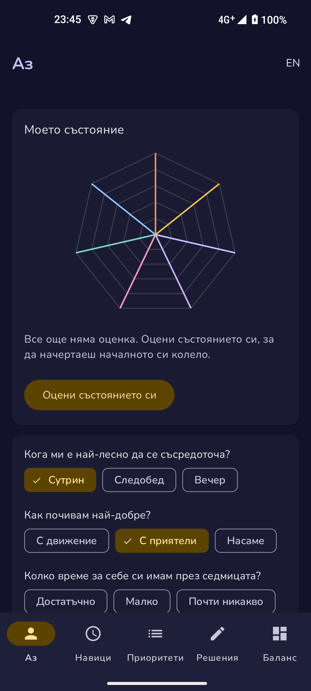
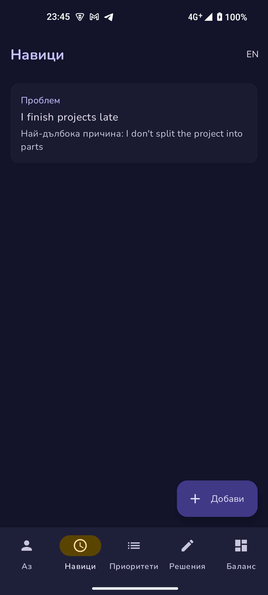
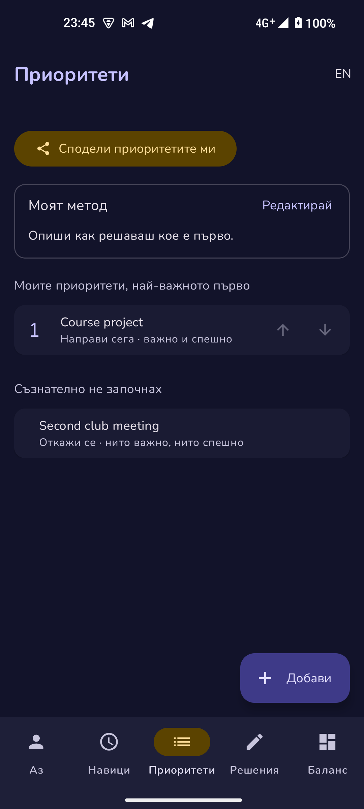
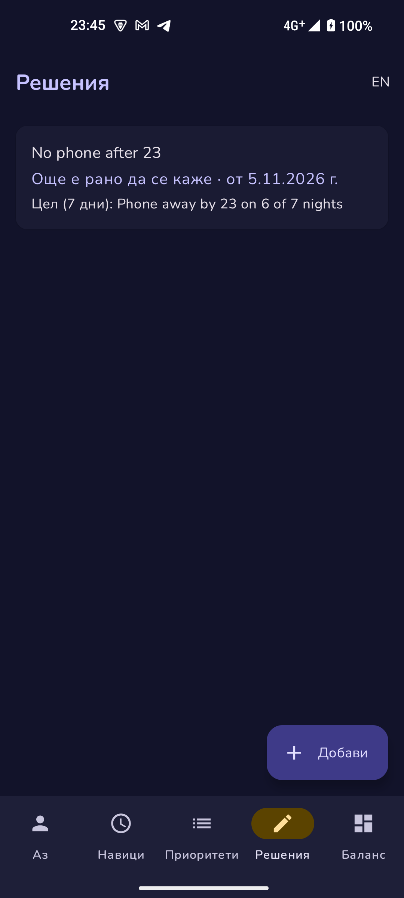
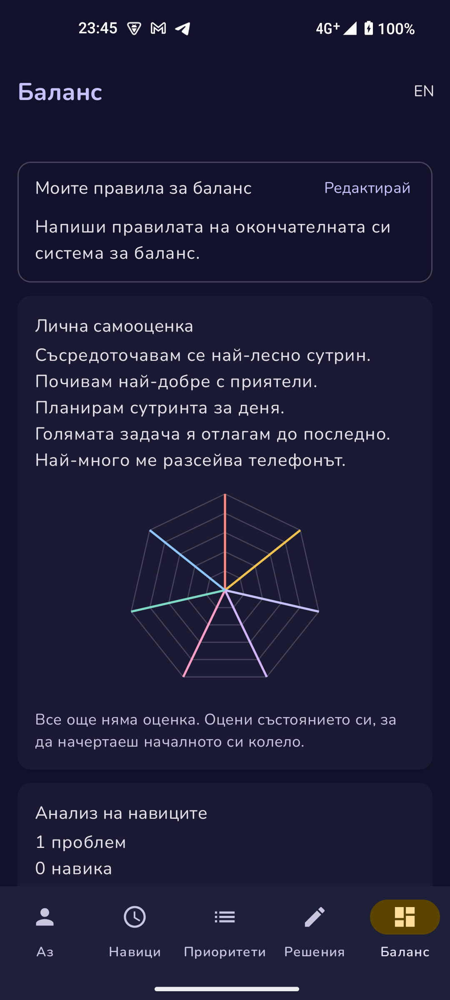

# Equilibra

Android приложение за баланс между учене и свободно време. Води те стъпка по стъпка: от това кой си и как управляваш времето си, през навиците и приоритетите ти, до решенията, които проследяваш, и твоята окончателна система за баланс.

**Изтегли приложението:** [apk/app-release.apk](apk/app-release.apk) (около 6 MB) · инструкции в раздел [APK](#apk)

## Съдържание
- [Идея](#идея)
- [Как работи](#как-работи)
- [Архитектура](#архитектура)
- [Потребителски поток](#потребителски-поток)
- [Стъпки за стартиране](#стъпки-за-стартиране)
- [Тестови акаунти](#тестови-акаунти)
- [Скрийншотове](#скрийншотове)
- [APK](#apk)

## Идея
Много студенти усещат, че нямат време, но не знаят къде точно отива то и какво да променят. Equilibra е лично интерактивно табло, което последователно преминава през всички стъпки на една система за баланс:

1. **Лична самооценка:** кой съм и как управлявам времето си?
2. **Анализ на навиците:** какви проблеми, навици и потребности откривам в ежедневието си?
3. **Приоритизиране:** по какъв начин подреждам приоритетите си?
4. **Проследяване на баланса:** как проследявам резултатите от решенията си?
5. **Краен резултат:** как изглежда моята окончателна система за баланс?

Всеки от петте раздела е отделен таб в долната лента, в този ред. Данните са реалните данни на потребителя и се пазят само на телефона му.

## Как работи

### 1. Аз (лична самооценка)
- **Моето състояние:** колело с 7 показателя: стрес, натовареност, мотивация, организация, свободно време, учебна ефективност и качество на почивката. Всеки се оценява от 1 (ниско) до 5 (високо) с плъзгач. При **стрес и натовареност по-ниското е по-добре** и това е отбелязано.
- Всяка оценка се пази с дата и вид: **Начална**, **Междинна** или **Крайна**. Колелото показва най-новата оценка като запълнена фигура, а началната като пунктир отгоре. Така се вижда „преди и след“, а легендата показва промяната (например „Стрес 4 → 2“). Може да има само една начална и една крайна оценка.
- **6 въпроса с избор**: 3 за това кой съм (кога се съсредоточавам, как почивам, колко време имам за себе си) и 3 за това как управлявам времето си (как планирам, какво правя с голяма задача, какво ме разсейва). Отговорът се запазва веднага при докосване.
- От отговорите се сглобява **обобщение** с две части, „Кой съм аз?“ и „Как управлявам времето си?“, например „Съсредоточавам се най-лесно сутрин. Голямата задача я отлагам до последно.“

### 2. Навици (анализ на навиците)
- Списък с **открития**, всяко от вид **проблем**, **навик** или **потребност**. Добавяне с бутона **Добави**, редакция и изтриване при докосване.
- За всеки **проблем** има **„Пет пъти защо?“**: до 5 последователни отговора на въпроса „Защо?“, от симптома към по-дълбоката причина. Последният попълнен отговор се показва в списъка като „Най-дълбока причина“.

### 3. Приоритети (приоритизиране)
- **Моят метод:** кратък текст за това как подреждаш приоритетите си.
- **Моите приоритети** в твоя ред (1 е най-важното), подреждани със стрелките ↑ ↓.
- За всеки приоритет отговаряш на два отделни въпроса, **Важно** и **Спешно**, и приложението показва какво да направиш:
  - **Направи сега** · важно и спешно
  - **Планирай** · важно, не спешно
  - **Делегирай или съкрати** · спешно, не важно
  - **Откажи се** · нито важно, нито спешно
- **Съзнателно не започнах:** отделен списък с нещата, които съзнателно решаваш да не започваш, за да запазиш важното и почивката си.
- **Сподели приоритетите ми:** изпраща списъка, групите и метода като текст през всяко приложение (Viber, Messenger, имейл и т.н.).

### 4. Решения (проследяване на баланса)
- Всяко решение (например „Без телефон след 23:00“) е **малък експеримент** със:
  - дата на започване
  - **хипотеза** (какво очаквам да се промени)
  - **SMART цел за 7 дни**
  - **как ще разпозная напредък**
- След седмицата избираш **резултат**: проработи, не проработи или още е рано да се каже. Можеш да запишеш и **какво се случи**.

### 5. Баланс (краен резултат)
- **Моите правила за баланс:** окончателните правила на твоята система.
- Под тях всичко се събира на едно място:
  - обобщението от самооценката и колелото „преди и след“
  - колко проблема, навика и потребности си открил и колко проблема си проследил с „Пет пъти защо?“
  - приоритетите ти в ред с групите им, и колко неща съзнателно не си започнал
  - колко решения са проработили, колко не и за колко е още рано да се каже

### Език
Приложението е на **английски и български**. Бутонът **БГ / EN** горе вдясно сменя езика веднага, без да рестартира екрана. По подразбиране се използва езикът на телефона.

## Архитектура
- **Kotlin**, минимален Android 7.0 (API 24), target API 37.
- **MVVM + Repository:**
  - **View:** фрагменти с XML layouts и ViewBinding. Те само показват данни и предават действията на потребителя.
  - **ViewModel:** пази състоянието на екрана, преживява завъртане и чете данните като `Flow`, превърнат в `StateFlow`.
  - **Repository:** единственият достъп до данните за ViewModel-ите (`TaskRepository`, `HabitsRepository`, `DecisionRepository`, `BalanceWheelRepository`, `ProfileRepository`).
  - **Domain** (`domain/`): правилата на приложението като чист Kotlin без Android класове, например подреждането на приоритетите, групите важно/спешно, „Пет пъти защо?“ и броенето за раздел Баланс.
- **Room** (SQLite): локална база данни `equilibra.db` с таблици за приоритети, открития, решения, оценки на колелото и профила. DAO-тата връщат `Flow`, затова екраните се обновяват сами при всяка промяна. Промените в базата са с миграции (`AutoMigration` и една ръчна `Migration`), така че данните се запазват при обновяване.
- **Hilt:** dependency injection за базата, DAO-тата, хранилищата и ViewModel-ите.
- **Navigation Component:** един `MainActivity` с долна навигационна лента и пет основни фрагмента, плюс екрани за редакция.
- **Material 3:** светла и тъмна тема („ден и нощ“) и шрифт Nunito.
- **Share Intent:** `ACTION_SEND` с обикновен текст от раздел Приоритети.
- **Колелото** е собствен `View`, нарисуван с `Canvas`, без библиотека за графики.

```
UI (Fragment + ViewBinding) → ViewModel (StateFlow) → Repository → DAO (Room) → SQLite
                                     ↑ domain/ (правила, чист Kotlin)
```

## Потребителски поток
1. Отваряш приложението → започва от **Аз**.
2. **Аз:** оценяваш състоянието си (Начална оценка) и отговаряш на 6-те въпроса. Виждаш обобщението.
3. **Навици:** добавяш проблемите, навиците и потребностите, които забелязваш. За проблемите търсиш причината с „Пет пъти защо?“.
4. **Приоритети:** записваш метода си, добавяш приоритети, отбелязваш важно/спешно, подреждаш ги и местиш в „Съзнателно не започнах“ това, което няма да правиш. По желание ги споделяш.
5. **Решения:** добавяш 1–2 решения като експерименти с хипотеза и SMART цел за 7 дни.
6. След 7 дни: отбелязваш резултата на всяко решение и правиш **Крайна** оценка на състоянието си в **Аз**.
7. **Баланс:** записваш правилата си и виждаш цялата си система на едно място.

## Стъпки за стартиране

### На телефон (без компютър)
Виж раздел [APK](#apk).

### От изходния код
1. Инсталирай **Android Studio** (последна стабилна версия).
2. Клонирай репото:
   ```
   git clone https://github.com/AlexanderSlivarov/MobileApps2026-2401321058.git
   ```
3. Отвори папката в Android Studio и изчакай Gradle sync.
4. Свържи Android телефон с включен **USB debugging** (или стартирай емулатор).
5. Натисни **Run ▶**.

APK файлът се прави с `./gradlew assembleRelease` и се появява в `app/build/outputs/apk/release/`.

## Тестови акаунти
Няма. Приложението **не изисква регистрация или вход**. Всички данни се пазят локално на устройството.

## Скрийншотове
| Аз | Навици | Приоритети | Решения | Баланс |
|---|---|---|---|---|
|  |  |  |  |  |

## APK
Файл: [`apk/app-release.apk`](apk/app-release.apk), около 6 MB, за Android 7.0 и по-нови.

**Инсталиране на телефон:**
1. Отвори линка [apk/app-release.apk](apk/app-release.apk) от телефона и натисни **Download** (иконата със стрелка надолу).
2. Отвори изтегления файл.
3. Ако телефонът попита, разреши инсталиране от този източник (**Настройки → Инсталиране на неизвестни приложения**).
4. Натисни **Инсталирай** и после **Отвори**.

APK файлът е подписан с debug ключа на Android Studio. Инсталира се нормално, но не е предназначен за публикуване в Google Play.
